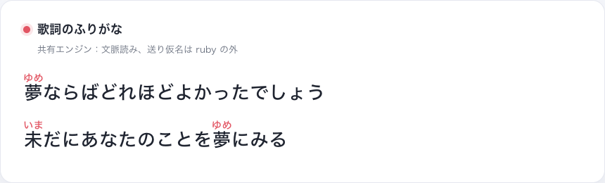
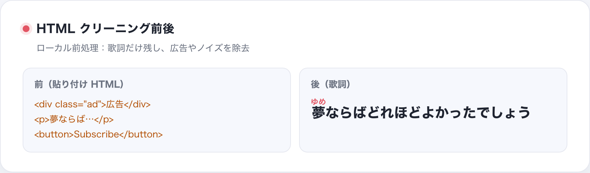
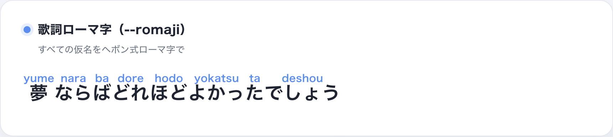

# Utayomi

**[English](README.md) | [简体中文](README.zh-CN.md) | [日本語](README.ja.md)**

日本語の歌詞に特化した Agent Skill です。貼り付けられた歌詞はローカルで処理し、曲名や歌手名で検索してほしいと明示された場合だけ Uta の検索機能を使います。

## 解決する問題

歌詞は汚れています：貼り付けたページには HTML・広告・ノイズが混ざり、
読みは文脈依存です。Utayomi は、貼り付けた歌詞をローカルで整理し、明示的な
検索依頼には Uta の歌詞サービスを使って、注音・翻訳・表示までを一つの流れにします。

## こだわっている点

- **原文保証**：すべての token の `orig` が入力を再構成する。
- **文脈読み**：`japanese-language-core` の Sudachi 読み API。
- **送り仮名**：かなは ruby の外（`踏み込む`・`歌う` を丸ごと包まない）。
- **出典を保持**：検索した場合は選択した提供元をページに表示する。
- **翻訳の文脈**：曲全体と前後の行を見て訳し、行構造と繰り返しを保つ。
- **出力検証**：原文の再構成、Ruby の完全性、歌詞と訳文の行対応を確認する。
- **検索の明示性**：ユーザーが歌詞を貼り付けた場合は検索せず、検索依頼がある場合だけ Uta を呼び出す。

## 実際の例

入力：

```text
雨が降り止むまでは帰れない
```

共有エンジンで検証した出力例：

```html
<ruby>雨<rt>あめ</rt></ruby>が<ruby>降<rt>ふ</rt></ruby>り<ruby>止<rt>や</rt></ruby>むまでは<ruby>帰<rt>かえ</rt></ruby>れない
```

`降り止む` は文字単位の推測ではなく文脈読みです。このサンプルは共有エンジンの
契約テストに含まれています。

<p align="center">
  
  <br><sub>歌詞ふりがな：文脈読み、送り仮名は ruby の外</sub>
</p>

## アプローチ：証拠・再現・反証可能性

「モデルが賢く見える」ことだけを読み品質の証明にしません：

1. **文脈優先**：共有読音エンジンで読みを生成し、原文と Ruby の整合を確認します。
2. **制約を明示**：固定ルールであらゆる読みを正解とみなさず、未検証の読みは報告します。
3. **歌詞の検索**：検索依頼に限り Uta を使い、複数候補が紛らわしければ選択後に取得します。
4. **翻訳の構造**：Agent が曲全体の文脈で翻訳または推敲し、行対応を検証します。

## ワークフロー

### 歌詞検索

検索を明示的に頼まれた場合だけ Uta CLI を使い、候補を表示します。候補に曖昧さがあれば選択を待ってから取得します。検索用の歌詞クライアントを Utayomi に複製しません。

    furigana-lyrics lyrics search --query 'TITLE ARTIST' --limit 5
    cat selected-candidate.json | furigana-lyrics lyrics fetch --candidate-json -

取得結果の plain_lyrics を本文として処理し、曲名、歌手、出典は別のメタデータとして渡します。生成ページには出典名を表示します。start_ms 付きのデータも返りますが、静的ページにはタイムラインを表示しません。貼り付けられた歌詞は検索せずに処理します。

### 入力整理

`prepare_lyrics.py` はユーザーが提供したテキストだけを扱います。
HTML タグや `script`/`style` を除去し、エンティティをデコードして、
繰り返し・括弧・ハーモニーマーカー・改行を保ちます。貼り付け入力の URL を
自動取得することはありません。歌名検索は明示依頼時に Uta CLI を使います。

<p align="center">
  
  <br><sub>HTML クリーニング：歌詞だけ残し、広告やノイズを除去</sub>
</p>

### 注音エンジン

`japanese-language-core` の `ReadingToken` 契約を利用し、共有 API の
`auto` エンジンで原文を保ったまま注音します。エンジンや辞書の選択は
アプリ内部で行い、利用者に設定を求めません。歌詞の整理、翻訳、タイトル判定と
ページ表示は Utayomi の製品層です。

## コア機能

- 平仮名注音と明示要求時のヘボン式ローマ字。
- 文脈読みと送り仮名の分離。
- 貼り付けたプレーンテキスト／HTML の清掃。
- 翻訳の初稿作成または既存訳の推敲と行対応。
- Uta による明示的な歌詞検索、選択候補の取得、出典表示。
- Codex Skill と `PROMPT.md` の Agent 統合。
- 静的 HTML ページでの対訳表示。検索結果の時間軸は表示しません。

<p align="center">
  
  <br><sub>明示要求時のローマ字モード（--romaji）</sub>
</p>

## 使い方

### Agent モード

リポジトリ全体をスキルとしてインストールし、`$utayomi` を参照します。
スキルフレームワークがなければ `PROMPT.md` を使います。

### CLI モード

この CLI はローカルの歌詞整理、注音、HTML 出力を担当します。翻訳は Agent が行います。

    printf '%s\n' '夢ならばどれほどよかったでしょう' | .venv/bin/python scripts/utayomi.py
    .venv/bin/python scripts/utayomi.py --file lyrics.txt
    .venv/bin/python scripts/utayomi.py --markdown < lyrics.txt
    .venv/bin/python scripts/utayomi.py --romaji < lyrics.txt

標準入力は標準出力へ出力します。ファイル入力では元ファイルを上書きせず、同じフォルダーに時刻付きの HTML または Markdown を作ります。

## インストール

```bash
python3 -m venv .venv
.venv/bin/python -m pip install -r requirements.txt
```

`requirements.txt` は `japanese-language-core[reading]` を固定バージョンで参照します。

Utayomi に Uta CLI は含まれません。歌名検索には、Agent の実行環境に
`furigana-lyrics` が別途インストールされ、ネットワークへ接続できる必要があります。
歌詞を貼り付けて処理する場合は CLI は不要です。

## 検証

```bash
PYTHONPATH=/path/to/japanese-language-core/src /path/to/python \
  -m unittest discover -s tests -v
```

回帰テストは歌詞の清掃、文脈読み、Ruby の整合性、HTML 生成、ファイル出力と
共有コア境界を確認します。

## 現在の境界

Utayomi は歌詞の清掃、注音、翻訳・推敲と HTML 表示を担当します。検索は明示的な依頼時だけ Uta CLI に委譲します。ユーザーが貼り付けた歌詞を外部へ送信せず、普通の日本語学習文は Bunomi に任せます。

## 方法とデータソース

- 読みは japanese-language-core の共有 API を使い、原文保持と漢字の読みカバレッジを検証します。
- 翻訳は Agent が歌全体と前後の行を見て作成または推敲し、行構造を保ちます。
- Uta が複数ソース検索、選択結果の取得、LRC 解析を提供します。Utayomi は二重実装しません。

## プロジェクト構成

    SKILL.md                 Agent Skill
    PROMPT.md                Skill 非対応環境向け Prompt
    scripts/utayomi.py       ローカル処理の統一入口
    scripts/prepare_lyrics.py HTML と LRC の整理
    scripts/utayomi_core.py  共有注音エンジンとの接続
    scripts/build_html.py    HTML 表示
    scripts/install_utayomi_skill.py Skill インストーラー
    tests/                   ローカル回帰チェック

## ライセンス

MIT。詳細は [LICENSE](LICENSE)。
