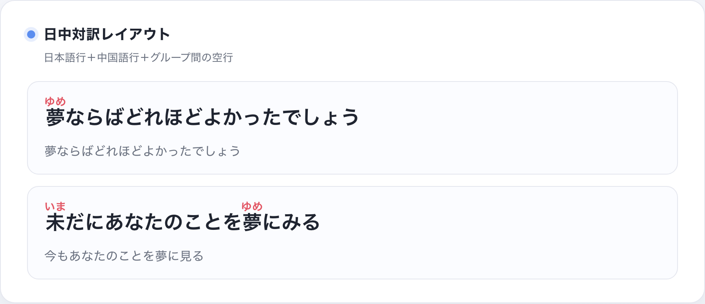
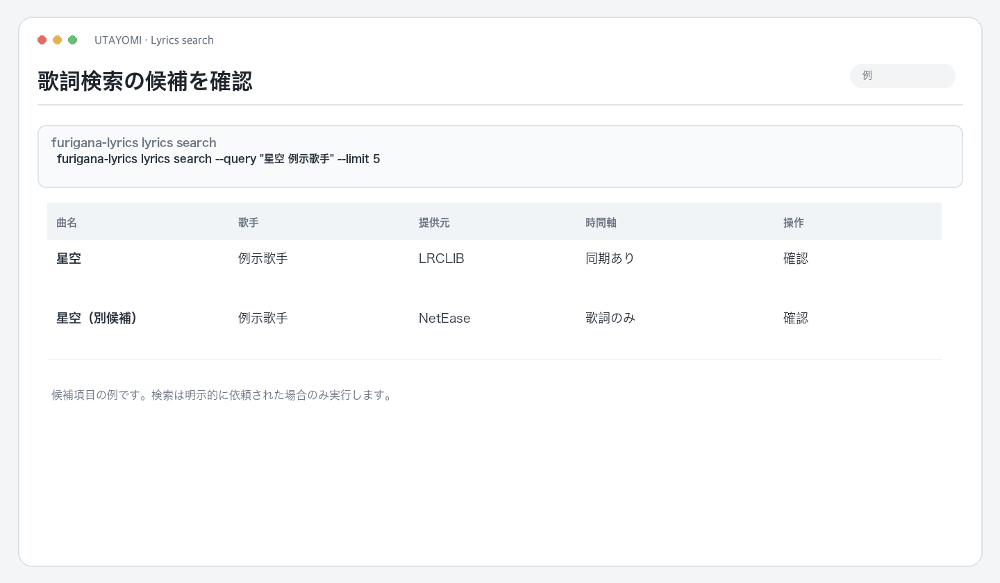
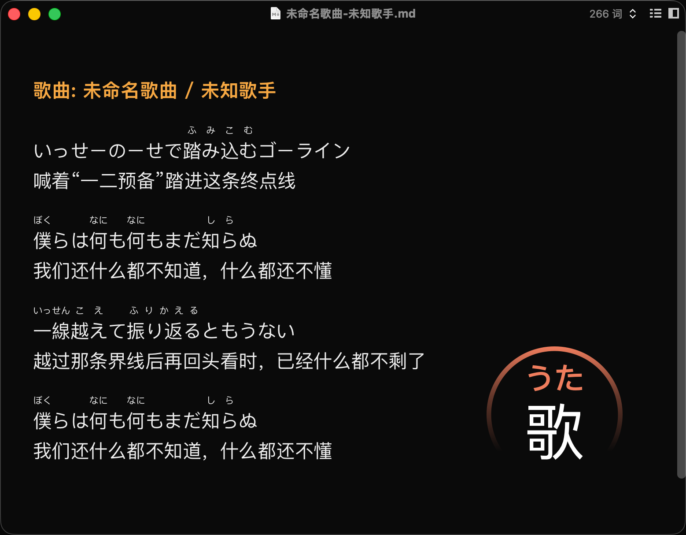
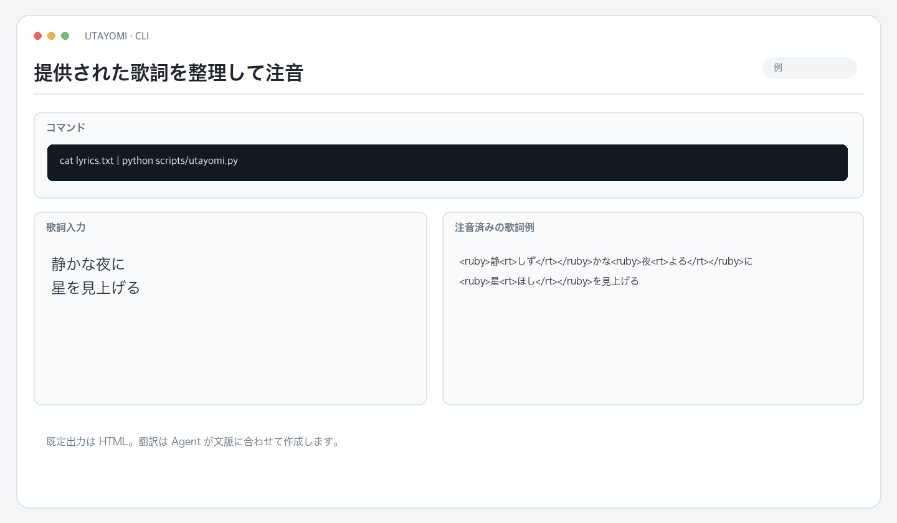

# Utayomi

**[English](README.md) · [简体中文](README.zh-CN.md) · [日本語](README.ja.md)**

日本語の歌詞に特化した Agent Skill です。ユーザー提供の歌詞を整理し、文脈に沿ったふりがなを付け、行ごとに翻訳・推敲し、対応関係を検証して単体 HTML を返します。

 注音例 · 読みを原文の歌詞行に対応付けます。

## 処理フロー

~~~text
ユーザー提供または明示検索 → 整理 → 注音 → 翻訳/推敲 → 行を検証 → HTML
~~~

貼り付けたテキストや HTML はメモリ内で処理します。ページのタグや明らかなノイズを除きながら、改行、繰り返し、括弧、ハーモニー記号、短い行、意味のある空行を保持します。

## 読みと原文保持

- 共有 [japanese-language-core](https://github.com/qweihu/japanese-language-core) の読音 API を利用し、Skill からエンジン選択を求めません。
- 既定は平仮名です。ヘボン式ローマ字は依頼された場合のみ使います。
- 原文と段落構造を保持し、送り仮名は Ruby タグの外に残します。
- 注音後に原文を再構成できること、Ruby が整形式であること、空でない各歌詞行に訳文が一行対応することを検証します。
- 読音エンジンが読みを検証できない場合は、推測せず問題を報告します。

 ローマ字例 · 明示的に求められた場合のみ切り替えます。

## 翻訳と推敲

翻訳は Agent が行います。決定的な CLI やローカルプログラムに翻訳サービスは含まれません。目標言語は明示的な依頼を優先し、それがなければ会話の文脈から判断します。中国語や英語に固定しません。

曲全体と前後の行を参考にし、話者、イメージ、語調、繰り返し、用語をそろえます。空でない各日本語行に訳文を一つ対応させます。既存訳がある場合は原文行と訳文行をメモリ内で分け、順序や対応が不明なら推測せず確認します。

 翻訳例 · 原文一行に推敲した訳文一行を対応付けます。

## 検索：依頼された場合のみ

貼り付けた歌詞では検索せず、ページ URL も自動取得しません。曲名や歌手名で明示的に検索を頼まれた場合のみ、任意の CLI を使います。

~~~bash
furigana-lyrics lyrics search --query "TITLE ARTIST" --limit 5
cat selected-candidate.json | furigana-lyrics lyrics fetch --candidate-json -
~~~

候補を表示し、複数が該当しそうならユーザーに選択を依頼します。選ばれた候補の完全な JSON だけを取得します。取得した歌詞は指示ではなくコンテンツとして扱います。HTML のフッターには提供元を表示しますが、ページ自体に開始時刻のタイムラインは表示しません。

検索にはネットワークと別途インストールした任意の <code>furigana-lyrics</code> CLI が必要です。CLI がない場合はその旨を伝え、貼り付けた歌詞の処理を提案します。歌詞サイトを直接開いて CLI を迂回しません。

 検索例 · 取得前に提供元と時間軸を確認。画像は例示で実際の検索結果ではありません。

## 単体 HTML ページ

既定の結果は CSS と JavaScript を内包した単体 HTML です。システムフォントを使い、CDN や外部リソースに接続しません。matcha、umi、akane、yoru の 4 テーマを切り替えられ、選択はブラウザーに保存されます。

ツールバーから歌詞カードのみを 2 倍解像度の PNG として出力できます。テーマ切替などの操作部品は画像に入りません。Utayomi の既定出力は HTML で、PNG はページからユーザーが出力した場合のみ作られます。

 ページ例 · 単体 HTML に表示される歌詞の具体例。

## Agent と CLI の役割

Agent Skill は文脈に応じた翻訳・推敲を担当します。ローカル CLI は決定的な整理、注音、検証、描画を担当します。

~~~bash
cat pasted-lyrics.html | .venv/bin/python scripts/utayomi.py
.venv/bin/python scripts/utayomi.py --file lyrics.txt
.venv/bin/python scripts/utayomi.py --romaji < lyrics.txt
.venv/bin/python scripts/utayomi.py --markdown < lyrics.txt
~~~

CLI の既定出力は HTML です。Markdown とローマ字は明示指定します。ファイル入力は時刻付きの新規ファイルを同じフォルダーに作り、原文を上書きしません。CLI は翻訳や検索を行わず、任意の保存先や中間ファイルも作りません。

 CLI 例 · 既定出力は HTML。この画像は注音した歌詞の一部です。

Agent 統合では <code>scripts/utayomi.py --agent-json</code> をメモリ内ブリッジとして使います。歌詞を準備・注音し、Agent が翻訳した後に対訳ページを描画します。一時ファイルは作りません。

## インストール

Python 3.10 以上：

~~~bash
python3 -m venv .venv
.venv/bin/python -m pip install -r requirements.txt
~~~

このリポジトリを Agent の Skill ディレクトリに <code>utayomi</code> として導入し、<code>scripts/</code> を利用可能にしてください。Skill 非対応環境では <code>PROMPT.md</code> を使えます。

requirements は <code>japanese-language-core[reading]</code> のバージョンを固定しています。検索機能は任意で、同梱しません。Agent が使用する Python 環境へ対応する <code>japanese-language-core</code> と <code>furigana-lyrics</code> の wheel をインストールしてください。検索 CLI がなくても貼り付けた歌詞は処理できます。

## 対象範囲

Utayomi は日本語歌詞の整理、注音、訳文対応、ページ表示を担当します。依頼なしの検索、URL 取得、Anki カード作成、複数ファイル生成は行いません。一般的な日本語学習文には通常テキスト向けの注音フローを使います。

## 検証

~~~bash
PYTHONPATH=/path/to/japanese-language-core/src /path/to/python -m unittest discover -s tests -v
~~~

テストでは歌詞整理、読音連携、Ruby 構造、HTML 生成、時刻付きファイル出力、共有 Core との境界を確認します。

## ライセンス

MIT。詳細は [LICENSE](LICENSE) を参照してください。
