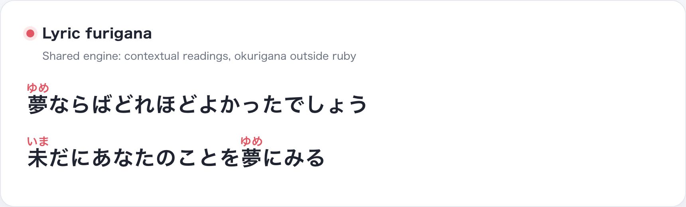
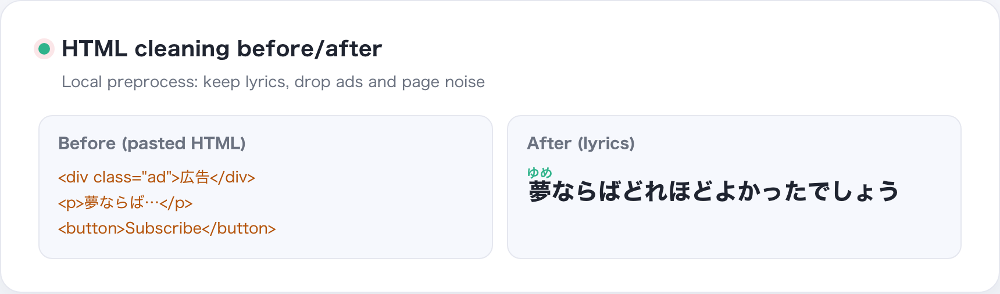
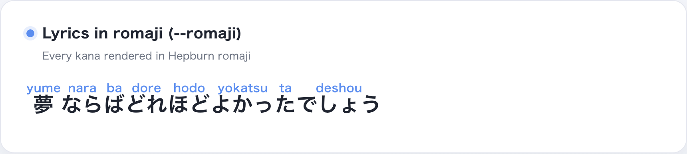
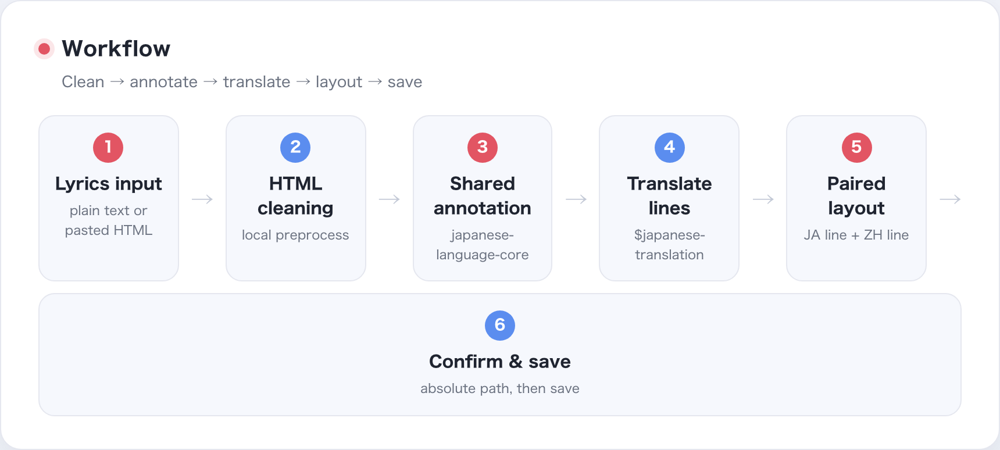

# Utayomi

**[English](README.md) | [简体中文](README.zh-CN.md) | [日本語](README.ja.md)**

An Agent-facing **Japanese lyric annotation skill**: it cleans user-pasted
lyrics locally, adds contextual `<ruby>` furigana (hiragana or romaji) with
the shared engine, pairs each line with a translation in the user's language,
and renders the final HTML in memory.

## What problem does it solve?

Pasted lyric pages contain HTML and noise, and Japanese readings depend on
context. Utayomi cleans pasted lyrics locally, then annotates, translates or
polishes, and renders a paired page. An explicit title/artist search is
available through the optional `furigana-lyrics` CLI; translation is generated
by the Agent and is not a deterministic dictionary lookup.

## Where the care shows

- **Source fidelity**: every token's `orig` must reconstruct the input.
- **Contextual readings**: `japanese-language-core` selects the available
  reading capability internally.
- **Okurigana handling**: kana stays outside the ruby element
  (`踏み込む`, `歌う` are not wrapped whole).
- **Translation context**: translate or polish with whole-song and neighboring-line context while preserving line structure and refrains.
- **Output validation**: checks source reconstruction, Ruby integrity and one-to-one lyric/translation rows.
- **Explicit search**: pasted lyrics stay local; the optional `furigana-lyrics` CLI searches only after the user asks.

## A real example

Input:

```text
雨が降り止むまでは帰れない
```

The shared engine output example:

```html
<ruby>雨<rt>あめ</rt></ruby>が<ruby>降<rt>ふ</rt></ruby>り<ruby>止<rt>や</rt></ruby>むまでは<ruby>帰<rt>かえ</rt></ruby>れない
```

`降り止む` uses a contextual reading instead of per-character guesses. This
sample is part of the shared engine's contract tests.

<p align="center">
  
  <br><sub>Lyric furigana: contextual readings, okurigana outside ruby</sub>
</p>

## Engineering approach: context and verifiable structure

Utayomi treats reading and translation as separate quality questions:

1. **Context first**: use the shared reading engine and validate source and Ruby output.
2. **No unsupported certainty**: do not describe an unreviewed reading as a proven correction.
3. **Reproducible checks**: keep reading behavior and line-structure checks in the repository.
4. **Explicit search**: title/artist searches run only after the user asks; ambiguous candidates are selected before fetching.

## Workflow

### Input cleaning

`prepare_lyrics.py` only processes text the user provided:

- removes HTML tags, `script`, `style` and structural noise;
- decodes HTML entities;
- recognizes explicit song/artist metadata;
- keeps repeated lines, brackets, harmony markers and original line breaks;
- never fetches lyrics automatically; explicit title/artist requests use the optional `furigana-lyrics` CLI.

<p align="center">
  
  <br><sub>HTML cleaning: keep lyrics, drop ads and page noise</sub>
</p>

### Lyrics search

Search only when the user asks to find lyrics by title or artist. Use the
installed `furigana-lyrics` CLI to show a small candidate list, then fetch the
complete JSON object for the candidate the user selects:

```bash
furigana-lyrics lyrics search --query "TITLE ARTIST" --limit 5
cat selected-candidate.json | furigana-lyrics lyrics fetch --candidate-json -
```

Pass the fetched `plain_lyrics` as lyric text and keep the title, artist and
provider in separate metadata fields. Pasted lyrics never trigger a search.
The rendered page displays the provider name; its static layout does not show
the source timestamps.

### Annotation engine

Utayomi consumes the minimal `ReadingToken` contract from
`japanese-language-core`:

```python
from japanese_language_core.reading import create_engine

engine = create_engine("auto")
tokens = tuple(engine.tokens("雨が降り止む"))
assert "".join(token.orig for token in tokens) == "雨が降り止む"
```

The application does not expose engine selection. Lyric cleaning, translation,
title detection and HTML rendering are Utayomi's product layer; contextual
reading is provided by the shared core.

## Core features

- **Hiragana furigana**: `<ruby>漢字<rt>かんじ</rt></ruby>`.
- **Romaji mode**: `--romaji` outputs Hepburn.
- **Contextual readings**: shared `japanese-language-core` engine.
- **Okurigana handling**: kanji and kana are annotated separately.
- **HTML cleaning**: plain text or pasted HTML.
- **Paired layout**: one translation in the requested or context-appropriate language below each Japanese line.
- **Agent integration**: Codex skill workflow plus `PROMPT.md` fallback.
- **Source display**: fetched lyrics retain their provider name in the HTML footer.
- **Local-first**: pasted lyrics are processed locally; explicit search sends only the query to lyric providers through the optional CLI.

<p align="center">
  
  <br><sub>Romaji mode (--romaji): every kana rendered in Hepburn romaji</sub>
</p>

## Usage

### Agent mode

Install the repository as a skill (the whole repo is the skill; it depends on
its local scripts), then reference `$utayomi`. For title/artist search, the
environment also needs the optional `furigana-lyrics` CLI. Without a skill
framework, use `PROMPT.md`.

### CLI mode

```bash
cat pasted-lyrics.html | .venv/bin/python scripts/utayomi.py
.venv/bin/python scripts/utayomi.py --file lyrics.txt
.venv/bin/python scripts/utayomi.py --romaji < lyrics.txt
.venv/bin/python scripts/utayomi.py --markdown < lyrics.txt
```

The default result is HTML. Markdown and romaji are explicit options. No
output-path, overwrite, parent-creation, legacy-engine or intermediate-file
workflow is exposed.

<p align="center">
  
  <br><sub>Workflow: lyrics input → cleaning → shared annotation → contextual translation → paired page</sub>
</p>

## Installation

```bash
python3 -m venv .venv
.venv/bin/python -m pip install -r requirements.txt
```

`requirements.txt` pins `japanese-language-core[reading]` at a fixed version.
When the shared package is installed, `PYTHONPATH` can be omitted.

Utayomi does not bundle the optional `furigana-lyrics` CLI. To enable
title/artist search, install matching `japanese-language-core` and
`furigana-lyrics` wheels into the Python environment used by your Agent. The
CLI is distributed separately from this Skill:

```bash
python -m pip install ./japanese_language_core-*.whl ./furigana_lyrics-*.whl
```

Search needs network access. Pasted lyrics still work without the CLI.

## Verification

```bash
PYTHONPATH=/path/to/japanese-language-core/src /path/to/python \
  -m unittest discover -s tests -v
```

The tests cover lyric cleaning, contextual readings, Ruby integrity, the
in-memory HTML entry point, timestamped file output and the shared-core
boundary.

## Current boundaries

Utayomi handles lyrics only: cleaning, annotation, translation pairing and
HTML rendering. Pasted lyrics are processed locally. Explicit search uses the
optional CLI and displays source information; Utayomi never uploads pasted
lyrics or overwrites source files. Ordinary learning-text
annotation is handled by a separate annotation skill.

## Methodology and data sources

- Reading contract: `japanese-language-core` selects the available engine and preserves the source text.
- Translation: the Agent uses whole-song and neighboring-line context; the shared core validates general line structure.
- Search: the optional CLI provides candidates and lyric fetching; Utayomi owns the Agent workflow and page rendering.

## Project structure

```text
SKILL.md                  # skill entry (the repository is the skill)
PROMPT.md                 # standalone prompt
README.md / README.zh-CN.md / README.ja.md
scripts/utayomi.py        # unified cleaning, annotation and output entry point
scripts/prepare_lyrics.py # internal HTML cleaning and metadata extraction
scripts/utayomi_core.py   # internal shared-engine adapter
scripts/build_html.py     # internal self-contained HTML renderer
scripts/run_tests.py      # test runner
tests/                    # unit and shared-engine contract tests
```

## License

MIT. See [LICENSE](LICENSE).
